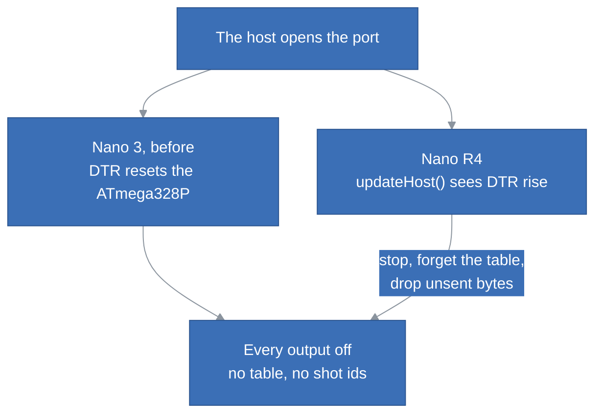

# The Arduino Nano R4

Pull request [#16](https://github.com/kineticsystem/stepit-freezer/pull/16), branch `nano-r4`.

## Goal

The Nano 3 of the Freezer board was replaced by an Arduino Nano R4. The firmware only ran on the ATmega328P: its sequencer drove Timer1 and port D directly. We port it to the R4, drop the Nano 3, and check on the rig that it works as before.

## Decisions

**GPT1 runs the shot.** It is a 32-bit timer counting at 48 MHz, so it needs no overflow interrupt to reach 32 bits, and it wraps after 89 s, far beyond a 10 s shot. Its compare match A ends each step, as OCR1A did. The core reserves it for the PWM of D3 and D11; the board drives D3 as a plain pin and leaves D11 free.

**The compare match outranks USB.** It runs at priority 2, USB at 12 and `millis()` at 14. The host polling the controller does not delay a boundary: the worst lateness is 2 to 3 µs, against about 5 µs on the Nano 3.

**The R4 starts again when the host opens the port.** The Nano 3 reset on DTR, through its FT232. The host relies on it: a node that restarts finds every output off and no table. The R4 has its own USB and no such reset; a real reset would drop the port the host has just opened. So the firmware forgets its state when DTR rises.

**The Nano 3 is dropped.** We first kept both boards, with the timer, the lock and the port writes per board. It cost a third of `Sequencer.cpp`, a second board to flash for every change, with no Nano 3 left on a board to test it, and the Nano 3's defaults on the host. The Nano 3's firmware stays at the tag `nano3-2.0.0`, which the driver still accepts.

**The host's defaults follow the R4.** `usb_port` is `/dev/ttyACM0`, not `/dev/ttyUSB0`, and `connect_delay` is 0, not 1 s: the R4 has no bootloader to wait for when the port opens, so each connection is a second shorter. The parameter stays, for a controller that resets.

**A 2-byte number is an `int16_t`.** `DataBuffer` wrote and read an `int` as 2 bytes. An `int` has 4 bytes on the R4, and `removeInt` left the top two uninitialised. Nothing broke yet, since every caller cast to 16 bits, but the next one would have.

**GCC 12.3.** The platform's GCC 7.2 has no build for the Raspberry Pi, which flashes the rig's board. GCC 12.3 has one, and we pin it in `platformio.ini` so that every computer builds the same firmware.

**A udev rule for DFU.** PlatformIO flashes the R4 with `dfu-util`, which writes to its USB device. On the Pi, without a desktop, only root may: the upload failed with `LIBUSB_ERROR_ACCESS`. The rule gives the device to `plugdev`, as the rig does for the cameras.

**Firmware 2.1.0.** The bytes on the wire did not change, so the major version stays 2, and the driver accepts it.

## Left Out

Lowering the 40 µs minimum hold. The R4 shifts a pattern much faster than the Nano 3, but the limit needs a measurement on the R4, with a logic analyser on `ST_CP`.

A real reset, `NVIC_SystemReset()`, when the port opens. It would drop the USB port under the host.

## Open Items

- Checked on the rig's Pi, with the R4 on the Freezer board: every command and error, the CRC, the busy refusals, `Stop`, 16 steps of 40 µs, a 2 s shot against the Pi's clock (2006 ms), and the restart when the port opens, by a script over the serial port. The node connected on its first try, and the `timed_light` shot of the rig fired the camera on OUT8 and the lights on OUT1.
- On the rig's Pi, the R4 connects at boot by itself: after a reboot, and after the Pi was switched off and on again, the node connected on its first try and a shot fired. The Nano 3 often had to be plugged in again after the Pi booted.
- Not checked on the R4: IN1, the remote trigger, and the timing on `ST_CP` with a logic analyser.
- The test script lives outside the repo. It could become a manual hardware check in `src/freezer_mcu`.
